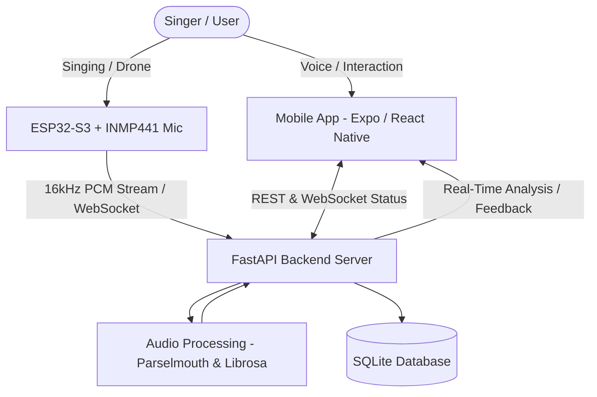

# SwarBodh: IoT-Based Vocal Sanctuary & Real-Time Training System

> **Bridging Ancient Indian Classical Music Traditions with Modern Bio-Acoustic Engineering and IoT**

---

## 📌 Overview

**SwarBodh** (Sanskrit for *"Vocal / Note Awareness"*) is an intelligent, bio-acoustic vocal health and training ecosystem. Designed for vocalists, students of Indian Classical music (Hindustani and Carnatic), and professional voice practitioners, SwarBodh acts as an interactive digital Guru.

By combining an external **IoT-based hardware node (ESP32-S3 + INMP441 MEMS Microphone)** with a high-performance **FastAPI audio intelligence server** and an **Expo / React Native mobile application**, SwarBodh delivers studio-grade vocal strain monitoring, micro-tonal pitch detection, and interactive practice guidance.

---

## ✨ Key Features

### 1. 🔍 Vocalytics (Real-Time Vocal Strain Analysis)
* **Acoustic Biofeedback**: Evaluates vocal health via **Jitter** (pitch period variation), **Shimmer** (amplitude variation), instability metrics, and loudness (dB).
* **Early Fatigue Warning**: Detects hyperfunctional voice use and vocal strain before physical damage occurs.
* **Guru's Counsel**: Offers personalized, context-aware advice (e.g., recommend Mandra Saptak practice for recovery).

### 2. 🎼 Intelligent Scale & Sargam Detection
* **Key Identification**: Employs the **Krumhansl-Schmuckler** algorithm to automatically detect the tonic pitch and musical scale of singer drones or ambient accompaniment.
* **Interactive Sargam Trainer**: Real-time feedback across Indian musical notes (*Sa, Re, Ga, Ma, Pa, Dha, Ni, Ṡa*).
* **Microtonal Precision (Cents)**: Evaluates pitch accuracy within **±60 cents** of the target Swara.

### 3. 🧘 Vocal Guru (Performance Analysis & Profiling)
* **Register Mapping**: Classifies vocal registers (Bass/Baritone, Tenor/Alto, Soprano).
* **Multilingual Recommendations**: Recommends songs tailored to vocal ranges across English, Hindi, and Marathi.
* **Vocal Profile History**: Tracks vocal consistency and breath control over time.

### 4. 🎛️ Digital Tanpura & Riyaaz Chamber
* **Full Three-Octave Drone Bank**: High-fidelity Tanpura drones across *Mandra* (Low), *Madhya* (Middle), and *Taar* (High) octaves for all 12 chromatic pitches.
* **Raga Context Association**: Automatically links tonic pitches to classical Ragas (e.g., Yaman, Bhairav, Kafi, Bhupali, Bageshri).
* **Intelligent Audio Management**: Automatic ducking prevents volume dips during active analysis.

### 5. 🛰️ IoT "Cloud Mic" Architecture
* **Hardware Decoupling**: Offloads audio capture from the smartphone microphone to an ESP32-S3 module with an INMP441 omnidirectional MEMS digital microphone.
* **Low-Latency Streaming**: Streams 16kHz, 16-bit mono PCM audio over WebSockets to the analysis backend with sub-150ms processing turnaround.
* **Hands-Free Riyaaz**: Allows singers to position the studio mic naturally without holding a smartphone.

### 6. 📂 The Vault & Session History
* Secure storage for practice sessions, audio captures, and vocal health logs.

---

## 🛠️ System Architecture & Tech Stack



### 📱 Frontend (Mobile App)
* **Framework**: React Native with [Expo](https://expo.dev/) (Expo Router)
* **UI & Styling**: Tailwind CSS (NativeWind), Linear Gradients, Custom Temple Gold & Crimson theme
* **Animation**: React Native Reanimated & Animated API
* **Audio**: `expo-av`

### ⚙️ Backend (Audio Engine & API)
* **Framework**: [FastAPI](https://fastapi.tiangolo.com/) (Python 3.10+) & Uvicorn
* **Communication**: WebSockets (low-latency streaming) & HTTP REST endpoints
* **Audio Intelligence**:
  * **Parselmouth (Praat)**: Jitter, shimmer, and vocal tract feature extraction
  * **Librosa**: Chromagrams, spectrograms, and pitch tracking
  * **NumPy & SciPy**: High-speed mathematical array operations
* **Database**: SQLite with SQLAlchemy ORM
* **Authentication**: JWT with Email OTP verification

### 🔌 Hardware (IoT Node)
* **Microcontroller**: ESP32-S3 (Dual-core, Wi-Fi 802.11 b/g/n)
* **Acoustic Sensor**: INMP441 MEMS Digital Microphone
* **Protocol**: I2S (Inter-IC Sound)
  * `SCK / BCLK`: GPIO 47
  * `WS / LRC`: GPIO 10
  * `SD / DATA`: GPIO 21

---

## 📁 Repository Structure

```
VoiceStrainDetector/
├── backend/                  # FastAPI server & audio processing engine
│   ├── analyzer.py           # Praat & Librosa analysis algorithms
│   ├── database.py           # SQLite / SQLAlchemy models and sessions
│   ├── main.py               # API routes, WebSocket bridge & auth
│   ├── requirements.txt      # Python dependencies
│   └── .env.example          # Sample environment configuration
├── mobile-app/               # Expo / React Native mobile client
│   ├── app/                  # Expo Router file-based screens
│   ├── assets/               # Visual and audio assets (Tanpura bank)
│   ├── src/                  # Components, context, and screens
│   └── package.json          # Node dependencies
├── PROJECT_REPORT_SUMMARY.md # Detailed project report summary
├── SYSTEM_DIAGRAMS.md        # Mermaid DFDs, UML, and ER diagrams
├── .gitignore                # Root Git ignore rules
└── README.md                 # Project documentation
```

---

## 🚀 Getting Started

### 1. Prerequisites
* **Python**: 3.10 or higher
* **Node.js**: 18.x or higher & `npm` / `yarn`
* **Expo CLI**: `npm install -g expo-cli`
* **Git**: Installed and configured

---

### 2. Backend Setup

1. Navigate to the backend directory:
   ```bash
   cd backend
   ```

2. Create and activate a Python virtual environment:
   ```bash
   # Windows
   python -m venv venv
   .\venv\Scripts\activate

   # Linux / macOS
   python3 -m venv venv
   source venv/bin/activate
   ```

3. Install dependencies:
   ```bash
   pip install -r requirements.txt
   ```

4. Configure environment variables:
   ```bash
   cp .env.example .env
   ```
   Edit `.env` to provide your SMTP email and App Password for OTP verification.

5. Start the backend server:
   ```bash
   uvicorn main:app --host 0.0.0.0 --port 8000 --reload
   ```

---

### 3. Mobile App Setup

1. Navigate to the mobile app directory:
   ```bash
   cd mobile-app
   ```

2. Install dependencies:
   ```bash
   npm install
   ```

3. Start the Expo development server:
   ```bash
   npx expo start
   ```

4. Scan the QR code using the **Expo Go** app on your iOS or Android device.

---

### 4. Hardware Wiring (ESP32-S3 to INMP441)

| INMP441 Pin | ESP32-S3 Pin | Function |
|-------------|--------------|----------|
| `VDD`       | `3.3V`       | Power    |
| `GND`       | `GND`        | Ground   |
| `SD`        | `GPIO 21`    | Data In  |
| `WS`        | `GPIO 10`    | Word Select (L/R Clock) |
| `SCK`       | `GPIO 47`    | Serial Clock |
| `L/R`       | `GND`        | Left Channel Select |

---

## 🔒 Security & Privacy

* Credentials and secrets (e.g., SMTP passwords, auth secrets) are excluded from version control via `.gitignore`.
* A `.env.example` template is provided for secure configuration.

---

## 📜 License & Acknowledgments

Developed by **Antigravity AI** for the **SwarBodh Project Team**.
Special thanks to the open-source audio intelligence ecosystems ([Parselmouth](https://github.com/YannickJadoul/Parselmouth), [Librosa](https://librosa.org/), [Praat](https://www.fon.hum.uva.nl/praat/)).
