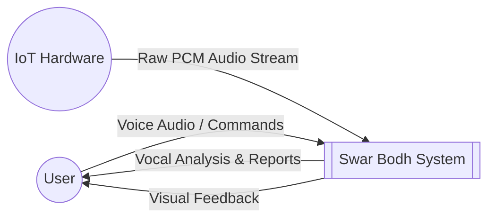
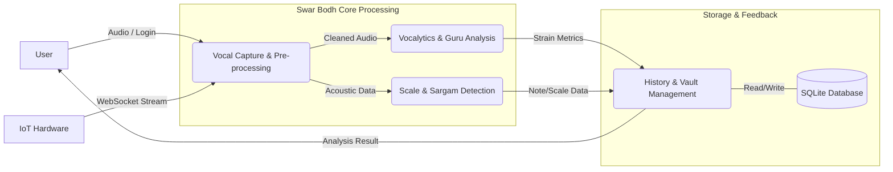
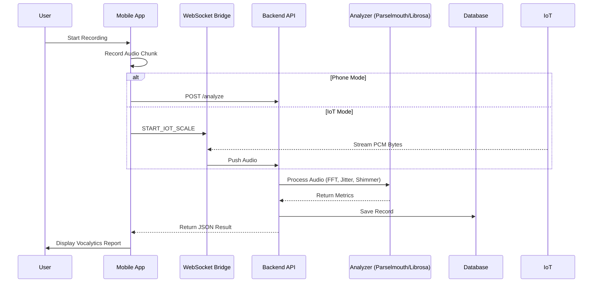
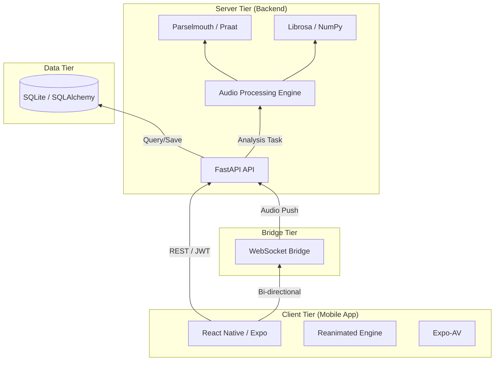
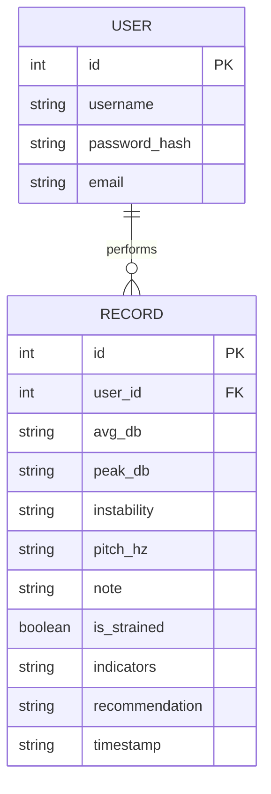
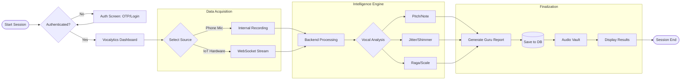

# Swar Bodh: System Architecture & Design Diagrams

This document contains the Data Flow Diagrams (DFD) and Unified Modeling Language (UML) diagrams for the Swar Bodh project. These diagrams are written in **Mermaid.js** syntax and can be rendered in VS Code, GitHub, or any Mermaid-compatible viewer.

---

## 1. Data Flow Diagrams (DFD)

### Level 0: Context Diagram
The context diagram shows the system as a single process and its interaction with external entities.



### Level 1: Main Processes
Breakdown of data flow between the Mobile App, Backend API, and Database.



---

## 2. UML Use Case Diagram
Defines the interactions between the users and the system's major features.

```mermaid
useCaseDiagram
    actor "Singer / Student" as User
    actor "ESP32 Hardware" as IoT
    
    package "Swar Bodh Application" {
        usecase "Authenticate (Login/OTP)" as UC1
        usecase "Real-time Strain Analysis" as UC2
        usecase "Vocal Guru (Full Song)" as UC3
        usecase "Sargam Practice" as UC4
        usecase "Tanpura Practice" as UC5
        usecase "Manage Recording Vault" as UC6
        usecase "Automatic Scale Detection" as UC7
    }
    
    User --> UC1
    User --> UC2
    User --> UC3
    User --> UC4
    User --> UC5
    User --> UC6
    User --> UC7
    
    IoT --> UC2
    IoT --> UC7
```

---

## 3. UML Sequence Diagram: Voice Analysis Flow
The typical interaction flow when a user performs a Vocalytics analysis.



---

## 4. UML Architecture Diagram
A high-level view of the technology stack and system components.



---

## 5. Entity Relationship (ER) Diagram
The database schema structure.



---

## 6. System Flowchart (Logical Execution Path)
This flowchart describes the end-to-step-by-step logic of a vocal session, from initialization to feedback.



---

## 🎨 Diagram Legend & Notes
- **DFD**: Focuses on the movement of data between internal and external sources.
- **UML Use Case**: Highlights "What" the system does for the user.
- **Sequence Diagram**: Highlights "How" components talk to each other in time.
- **ER Diagram**: Visualizes the data storage structure.

*Generated by Antigravity AI for the Swar Bodh Project Team.*
